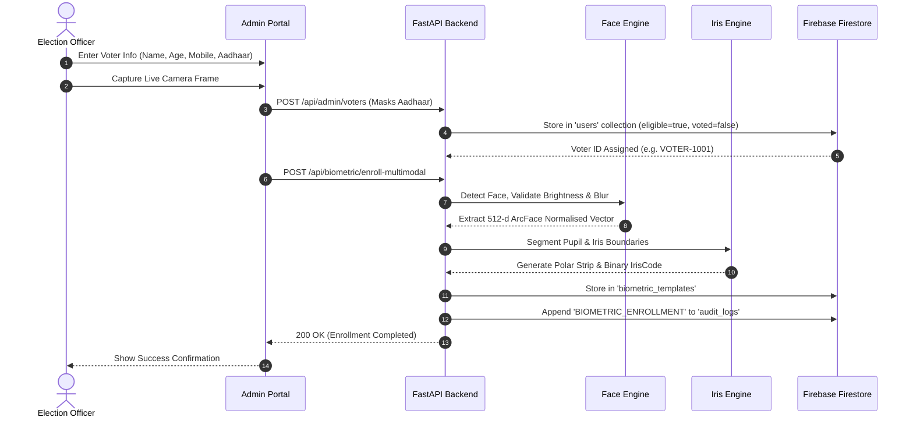
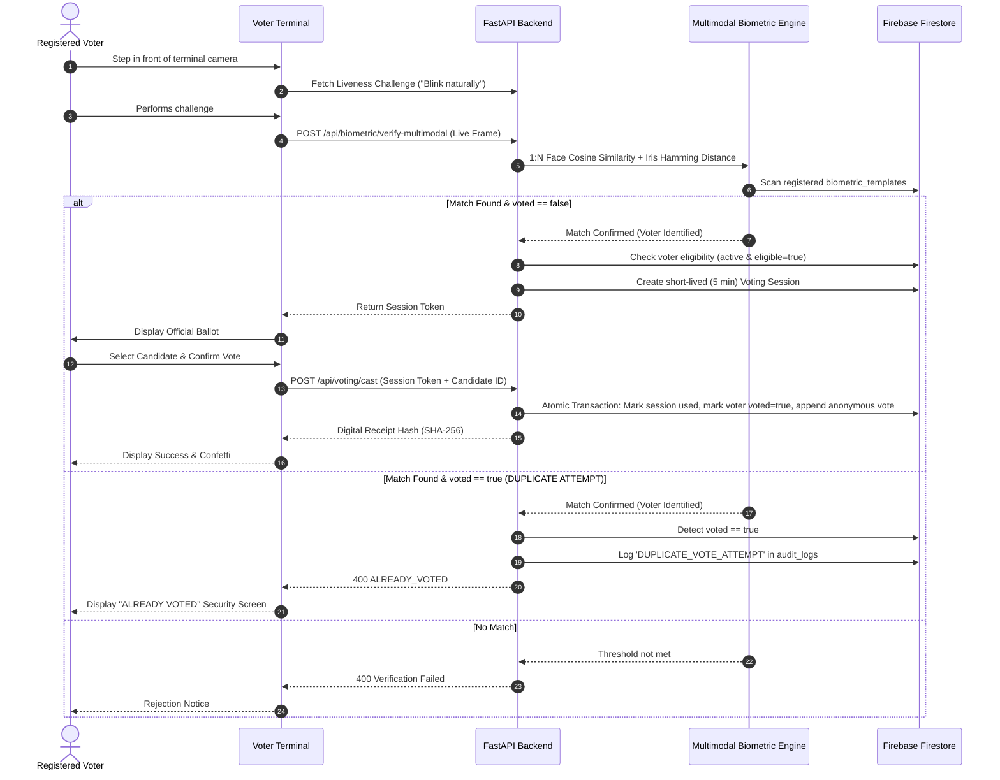
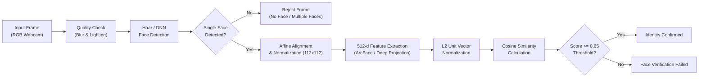
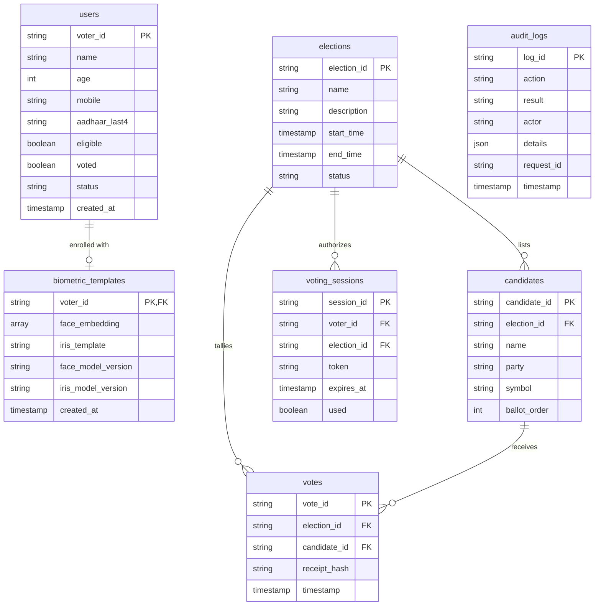
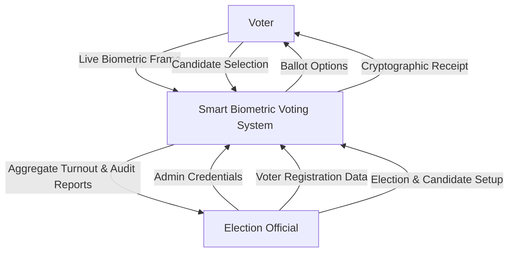
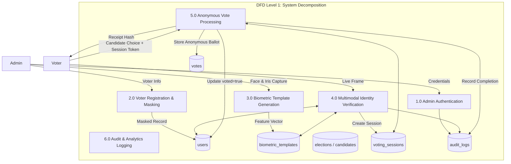

# Smart Biometric Voting System - UML & Architectural Diagrams

This document contains valid Mermaid diagrams representing all core engineering workflows of the Smart Biometric Voting System.

---

## 1. High-Level System Architecture

```mermaid
flowchart TB
    subgraph Client ["Client Presentation Tier (React 19 + Vite)"]
        Kiosk["Voter Kiosk Interface\n(/vote, /vote/verify, /vote/ballot)"]
        AdminUI["Admin Management Console\n(/admin/dashboard, /admin/voters, /admin/elections)"]
        WebcamModule["Webcam Capture Engine\n(HTML5 Canvas API + Quality Filter)"]
    end

    subgraph API ["Application Tier (FastAPI Python 3.11)"]
        RouterAuth["Auth & JWT Guard\n(/api/auth/*)"]
        RouterVoters["Voter Registry CRUD\n(/api/admin/voters/*)"]
        RouterBio["Biometric Verification Engine\n(/api/biometric/*)"]
        RouterVoting["Anonymous Ballot Engine\n(/api/voting/*)"]
        RouterAudit["Audit Logger\n(/api/admin/audit-logs)"]
    end

    subgraph CV ["Computer Vision & Biometric Pipelines"]
        FaceEngine["Face Recognition Pipeline\n(OpenCV Haar + 512-d ArcFace Normalized Vector)"]
        IrisEngine["Iris Recognition Pipeline\n(Daugman Rubber Sheet + Gabor Phase Code)"]
        LivenessEngine["Liveness Challenge Engine\n(Blink / Motion Challenge)"]
    end

    subgraph DB ["Persistence Tier (Firebase Cloud Firestore)"]
        ColUsers[("users")]
        ColBio[("biometric_templates")]
        ColElections[("elections")]
        ColCandidates[("candidates")]
        ColSessions[("voting_sessions")]
        ColVotes[("votes (anonymous)")]
        ColAudits[("audit_logs")]
    end

    WebcamModule -->|Base64 JPEG Frame| RouterBio
    RouterBio --> FaceEngine
    RouterBio --> IrisEngine
    RouterBio --> LivenessEngine
    FaceEngine --> ColBio
    IrisEngine --> ColBio
    RouterBio --> ColUsers
    RouterBio --> ColSessions

    Kiosk -->|Cast Ballot with Session Token| RouterVoting
    RouterVoting --> ColSessions
    RouterVoting --> ColUsers
    RouterVoting -->|Atomic Store (No Voter ID)| ColVotes
    RouterVoting --> ColAudits

    AdminUI --> RouterAuth
    AdminUI --> RouterVoters
    RouterVoters --> ColUsers
    RouterAuth --> ColAudits
```

---

## 2. Voter Registration & Biometric Enrollment Workflow



---

## 3. Multimodal Voting & Duplicate Prevention Workflow



---

## 4. Face Recognition Pipeline



---

## 5. Iris Recognition Pipeline

```mermaid
flowchart LR
    Ocular["Eye Region\nCrop"] --> Quality["Ocular Quality Check\n(Laplacian Focus Score)"]
    Quality --> Pupil["Pupil Boundary Localization\n(Min Intensity + Hough / Contours)"]
    Pupil --> Limbic["Outer Iris Limbic\nBoundary Estimation"]
    Limbic --> Daugman["Daugman Rubber Sheet\nPolar Unwrapping (32x128)"]
    Daugman --> Filter["2D Gabor Wavelet\nPhase Quantization"]
    Filter --> IrisCode["Binary IrisCode\nHex Representation"]
    IrisCode --> HD["Fractional Hamming Distance\nHD = (Code1 XOR Code2) / Total"]
    HD --> HDCheck{"HD <= 0.38\nThreshold?"}
    HDCheck -->|Yes| IrisMatch["Iris Verified Authentic"]
    HDCheck -->|No| IrisNoMatch["Iris Rejected"]
```



---

## 6. Database Entity-Relationship Model (Firebase Collections)



---

## 7. Data Flow Diagram (DFD Level 0 - Context Diagram)



---

## 8. Data Flow Diagram (DFD Level 1)


